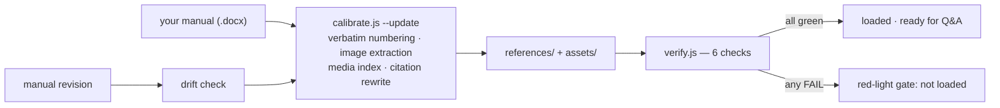

<div align="center">

# doc-qa-factory

**Turn any manual into a verifiable Q&A assistant.**

逐字原文编号锚定 · 图片按章节归属 · 六项一致性校验 · 改版自动重标定

[](https://github.com/vercel-labs/skills)
[](https://github.com/anthropics/skills)
[](https://github.com/vercel-labs/skills)
[](LICENSE)

[English](README.md) | [简体中文](README.zh-CN.md)


</div>

---

An Agent-Skill-format toolkit that loads any product manual / SOP / policy document into a **traceable** Q&A assistant: every answer carries a numbered citation back to the verbatim source text, illustrations are filed by the section they appear in, specific values are never invented, and a manual revision is re-calibrated automatically.

The repo ships with a **fully fictional** demo knowledge base (a desktop sparkling-water maker manual) — install it as a skill and just talk to your agent in plain language. It runs the whole pipeline for you.

## Install

Built and tuned for Claude Code, Codex, Cursor and 70+ more skills-compatible agents. The simplest way is to hand your agent the link:

```
Install this skill for me: https://github.com/zhanghaojie513/doc-qa-factory
```

Or with the [skills](https://github.com/vercel-labs/skills) CLI (auto-detects the agents on your machine and installs into each one's skills directory):

```bash
npx skills add zhanghaojie513/doc-qa-factory
```

Or by hand:

```bash
git clone https://github.com/zhanghaojie513/doc-qa-factory.git
cd doc-qa-factory
ln -s "$(pwd)" ~/.claude/skills/doc-qa-factory   # Claude Code
ln -s "$(pwd)" ~/.codex/skills/doc-qa-factory    # Codex
ln -s "$(pwd)" ~/.agents/skills/doc-qa-factory   # generic skills directory
```

In mainland China, if GitHub is slow, prefix the clone URL with a proxy such as [gh-proxy](https://gh-proxy.com/) (e.g. `git clone https://gh-proxy.com/https://github.com/zhanghaojie513/doc-qa-factory.git`).

Runs on Node 18+ with **zero npm dependencies** — every script uses Node built-ins only. `ffmpeg` is optional (it auto-degrades to raw copies when missing).

Then just say it — no commands to memorize:

| You say | The assistant does |
|---|---|
| "Load the demo manual." | Calibrates the fictional manual: builds the numbered verbatim baseline, extracts the illustrations and files them by section, then runs six consistency checks — you just see **all green** |
| (any question before anything is loaded) | Tells you honestly the knowledge base isn't loaded — verify exits with code **2** — and offers to load the demo or your manual; it never answers from memory or the sample files |
| "The machine shows E1 — what do I do?" | Answers with an actionable, checkable procedure, cites the source line (M015), and **sends the related illustration as a file** |
| "Swap in my company's manual: `D:\docs\printer.docx`" | 🔴 Confirms with you first, archives the demo knowledge base, rewrites the per-manual config, re-calibrates, rebuilds the Q&A playbook — and ships **only after verify is all green** |
| "Which manual is loaded right now?" | Reads the calibration record and reports name / version / checksum |
| "Bring the demo manual back." | Restores the archive, after a 🔴 confirmation |

<details>
<summary>What the assistant runs under the hood (you never type these yourself)</summary>


```bash
node scripts/calibrate.js demo-manual.docx --update   # load: numbering baseline + illustrations + media index
node scripts/verify.js                                # six consistency checks → all green
node scripts/calibrate.js demo-manual.docx            # drift check after any manual revision
```

</details>

## How it works

One command turns a DOCX into a verified knowledge base; a second command proves it:



Everything the assistant later says must land on a line of `references/manual-source.md` — that single constraint is what makes citations, value checks, and drift detection all possible.

## What an answer looks like

> **Q: How do I replace the filter?**
>
> The filter lasts 60 days — when the panel shows `F0`, it's due (M010).
>
> 1. Unscrew the old filter (counter-clockwise)
> 2. Peel the sealing film off the new one
> 3. Screw the new one in (clockwise)
> 4. Hold 「Reset」 for 3 seconds to clear the notice
>
> 📎 The illustration `assets/screenshots/filter-01.jpg` (section 「Filter replacement」, image 1) is sent as a **file** whenever the runtime supports attachments. The assistant never describes what a picture shows — the section's text above is the source of truth.

> **Q: The machine shows `E1`.**
>
> `E1` = abnormal air pressure: check that the CO₂ canister is screwed in tight and still has gas, then press 「Gas」 to retry (M015). Still stuck → after-sales support, never disassemble the unit (M017). This section has **no illustration** — and the assistant says so honestly instead of inventing one.

## Three modes

| Mode | You say | The assistant does |
|---|---|---|
| **A · Build / swap** | "Load this manual" / "swap in our SOP" | 🔴 confirms plan → archives current KB → rewrites config → re-calibrates → rebuilds playbook → ships only when verify is all green |
| **B · Q&A** | anything about the loaded manual | actionable steps + numbered citations + illustration files first |
| **C · Manage** | "which manual is loaded?" / "bring back the demo" | reads the calibration lock / restores an archive after a 🔴 confirmation |

## Why this design

The biggest risk of LLMs answering manual questions is not "can't answer" — it's **confidently inventing**: a menu path that doesn't exist, a plausible-but-wrong parameter, an image described wrongly. Four mechanisms close those holes:

| Mechanism | How |
|---|---|
| **Verbatim-source anchoring** | The entire manual is transcribed verbatim and numbered (`M001`–`MNNN`, typos preserved) as the single fact baseline. Every fact in an answer must land on a number, e.g. "filter lifespan is 60 days (M010)" |
| **Images filed by section** | Illustrations are named by *where they appear* in the manual (`filter-01.jpg` = section 「Filter replacement」, 1st image) — never by "what I think the picture shows". The assistant sends the file or reports its position; it never describes or OCRs the image |
| **Six consistency checks** | `verify.js`: citation out-of-range / dead screenshot links / orphan files / value provenance / baseline tampering / prose-vs-source values — any `[FAIL]` blocks shipping |
| **Auto re-calibration on revision** | After a revision, `calibrate` matches each line by content fingerprint, finds where it moved, rewrites every `M###` citation and re-files images automatically — then reports what needs human attention (changed values, deleted lines, new content) |

## Swap in your own manual

You provide three things; the assistant does the rest (Mode A in `SKILL.md`):

1. **The DOCX file** — tell your agent its path; 🔴 it will confirm the swap plan with you before touching anything
2. **A green light** at the confirmation (archive → rewrite config → re-calibrate → rebuild playbook → verify gate)
3. **Insider knowledge** for the new playbook, if you have it: terminology aliases, contact persons, "what the manual does not cover" — the assistant drafts it, you correct it

The per-manual config it rewrites is `references/manual-config.json` (**the scripts themselves contain zero manual content**):

- `docTitle` / `docVersion` — manual name and version
- `expectedTitlePattern` — document-identity guard (a safety lock against calibrating an unrelated document; cross-document swaps use `--force-replace`)
- `headingStyles` — docx heading style IDs (defaults `Heading1`/`Heading2`; Chinese-Word internal style IDs also configurable)
- `imageSlugs` — section title → image filename prefix (unregistered sections get `sec-NN` automatically)
- `watchedValues` / `knownValues` — the specific values to watch (e.g. "valid for X hours"); each one triggers an alarm when the manual changes

Notes: **no ffmpeg?** the assistant still works — images are copied as-is instead of re-encoded. **Non-DOCX** (PDF/TXT/MD): the assistant builds the files manually following the existing formats, then runs the same verify gate. A hand-built knowledge base has no calibration lock — which means it is **protected from accidental `--update` overwrites** (the script refuses unless you pass `--force-replace`), and the assistant will tell you that drift detection isn't available for it.

## Why all-green matters (hard rules)

1. **Never invent specific values** — if the source doesn't have it, say so and route to the contact person; caught per-item by `knownValues` + prose comparison
2. **Never describe images** — image meaning comes from that section's text; send the file (preferred) or report its position, no OCR
3. **Red-light gate** — any `[FAIL]` in `verify.js` blocks "done" declarations; high-risk actions (swap / `--update` / archive restore) sit behind explicit 🔴 CHECKPOINTs requiring user confirmation

## FAQ

**Does it only support DOCX?**
DOCX is the fully automatic path (numbering, image extraction, media index). PDF/TXT/MD can be loaded by building the reference files manually — the same six-check verify gate applies.

**Can I keep several manuals at once?**
One is loaded at a time. Every swap archives the previous knowledge base to `archive/`, and any archive can be restored later (after a 🔴 confirmation).

**What if verify.js reports a failure?**
Nothing ships. `SKILL.md` carries a fix table for every `[FAIL]` — citation out of range, dead links, orphan files, value provenance, baseline tampering, prose-vs-source — each with a first-line fix and a last-resort fallback. Exit codes: **0** clean · **1** problems found · **2** nothing loaded yet.

**Is a hand-built (non-DOCX) knowledge base safe?**
Yes — arguably safer. Without a calibration lock it can't be overwritten by a stray `--update` (the script refuses), the verify gate applies in full, and the assistant openly states the one limitation: manual drift detection needs a lock, so it will tell you when that check isn't available.

**Where do my documents go?**
Nowhere. Everything runs locally: the docx is read in place, extracted images land in `assets/`, and nothing is uploaded to any service.

**Which runtimes are supported?**
Anything that reads Agent Skills (`SKILL.md`): Claude Code, Codex, Cursor, and 70+ more through `npx skills add`.

## Contributing

Issues and PRs welcome. When changing behavior, keep the three hard rules intact — they are the product, not decoration. Demo assets (docx, GIF, screenshots) regenerate from `build/`.

Mascot and social card were generated with `gemini-3-pro-image-preview`; the full candidate history with per-image prompts lives in `docs/logo-candidates/`.

## Repository layout

```
doc-qa-factory/
├── SKILL.md                     assistant rules (three modes: build/swap · Q&A · manage)
├── demo-manual.docx             demo manual (fully fictional, re-calibratable)
├── references/
│   ├── manual-config.json       per-manual config (guard/styles/image slugs/watched values) ← rewritten on swap
│   ├── operations.md            standard-operations digest (demo example)
│   ├── troubleshooting.md       troubleshooting digest (demo example)
│   ├── qa-playbook.md           per-manual Q&A playbook (demo example)
│   ├── manual-source.md         verbatim source (generated by calibrate, gitignored)
│   ├── manual-source.lock.json  calibration record (generated)
│   └── media-index.md           image/video → section index (generated)
├── assets/screenshots/          illustrations named by section (extracted from the docx)
├── scripts/
│   ├── docx.js                  dependency-free .docx reader (hand-rolled ZIP + WordprocessingML)
│   ├── zip.js                   dependency-free zip writer (deflate, fixed timestamps → reproducible bytes)
│   ├── calibrate.js             drift detection + re-calibration (numbering/images/index/citations, all automatic)
│   ├── verify.js                six consistency checks
│   └── package.js               distribution packaging (runs verify first; refuses on red)
└── build/                       demo assets & generators (docs GIF, demo docx)
```

## License

MIT
