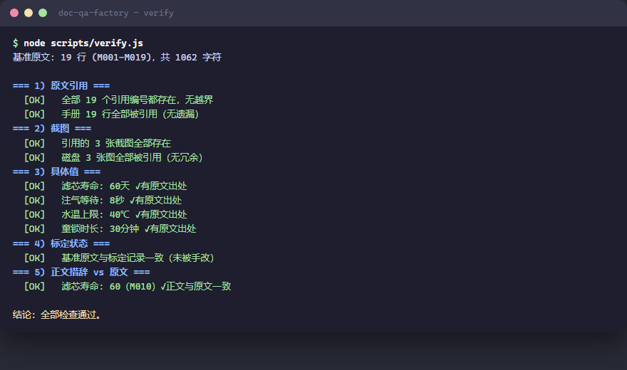

<div align="center">

# doc-qa-factory

**Turn any manual into a verifiable Q&A assistant.**

逐字原文编号锚定 · 图片按章节归属 · 六项一致性校验 · 改版自动重标定

[English](README.md) | [简体中文](README.zh-CN.md)


</div>

---

An Agent-Skill-format toolkit that loads any product manual / SOP / policy document into a **traceable** Q&A assistant: every answer carries a numbered citation back to the verbatim source text, illustrations are filed by the section they appear in, specific values are never invented, and a manual revision is re-calibrated with a single command.

The repo ships with a **fully fictional** demo knowledge base (a desktop sparkling-water maker manual) — clone it and run three commands to experience the whole pipeline.

```bash
node scripts/calibrate.js demo-manual.docx --update   # load the demo manual (numbering baseline, extract illustrations, build media index)
node scripts/verify.js                                # six consistency checks → all green
node scripts/calibrate.js demo-manual.docx            # drift check (run this first after a manual revision)
```



> Works as an Agent Skill (`SKILL.md` frontmatter: `name` + `description`) in any skills-compatible runtime, and reads perfectly well as a plain repository.

## Why this design

The biggest risk of LLMs answering manual questions is not "can't answer" — it's **confidently inventing**: a menu path that doesn't exist, a plausible-but-wrong parameter, an image described wrongly. Four mechanisms close those holes:

| Mechanism | How |
|---|---|
| **Verbatim-source anchoring** | The entire manual is transcribed verbatim and numbered (`M001`–`MNNN`, typos preserved) as the single fact baseline. Every fact in an answer must land on a number, e.g. "filter lifespan is 60 days (M010)" |
| **Images filed by section** | Illustrations are named by *where they appear* in the manual (`filter-01.jpg` = section 「Filter replacement」, 1st image) — never by "what I think the picture shows". The assistant sends the file or reports its position; it never describes or OCRs the image |
| **Six consistency checks** | `verify.js`: citation out-of-range / dead screenshot links / orphan files / value provenance / baseline tampering / prose-vs-source values — any `[FAIL]` blocks shipping |
| **Auto re-calibration on revision** | After a manual revision, `calibrate` matches each line by content fingerprint, finds where it moved, rewrites every `M###` citation and re-files images automatically — then reports what needs human attention (changed values, deleted lines, new content) |

## Load your own manual

1. Copy the repo as your skill directory, rename the skill in `SKILL.md` frontmatter
2. 🔴 Archive the demo knowledge base (`references/` + `assets/` → `archive/demo-date/`)
3. Rewrite `references/manual-config.json` (the per-manual config — **the scripts themselves contain zero manual content**):
   - `docTitle` / `docVersion` — manual name and version
   - `expectedTitlePattern` — document-identity guard (a safety lock against calibrating an unrelated document; pair with `--force-replace` for cross-document swaps)
   - `headingStyles` — docx heading style IDs (defaults `Heading1`/`Heading2`; Chinese-Word internal style IDs also configurable)
   - `imageSlugs` — section title → image filename prefix (unregistered sections get `sec-NN` automatically)
   - `watchedValues` / `knownValues` — the specific values to watch (e.g. "valid for X hours"); each one triggers an alarm when the manual changes
4. `node scripts/calibrate.js "<your manual.docx>" --update --force-replace`
5. Rewrite `references/qa-playbook.md` (terminology alignment / diagnosis tree / contact persons / "what the manual does not cover")
6. `node scripts/verify.js` — **all green or it isn't loaded** (red-light gate)

**No ffmpeg?** `calibrate` degrades gracefully: copies images as-is (skips re-encoding) instead of failing.

**Non-DOCX** (PDF/TXT/MD): build the files manually following the existing formats, then run `verify.js` (see Mode A in `SKILL.md`).

## Using it as an Agent Skill

| Runtime | Install |
|---|---|
| Claude Code | put it in `~/.claude/skills/doc-qa-factory/` (or project `.claude/skills/`) |
| Generic skills directory | put it in `~/.agents/skills/doc-qa-factory/` |
| Any other Agent-Skills-compatible runtime | register the directory containing `SKILL.md` per your runtime's docs |

Example triggers: "the machine shows E1, what do I do?", "send me the relevant picture", "I want to swap in my company's manual" — the frontmatter description makes runtimes hit even without the word "manual".

## Repository layout

```
doc-qa-factory/
├── SKILL.md                     assistant rules (three modes: build/swap · Q&A · manage)
├── demo-manual.docx             demo manual (fully fictional, re-calibratable)
├── references/
│   ├── manual-config.json       per-manual config (guard/styles/image slugs/watched values) ← you rewrite this on swap
│   ├── operations.md            standard-operations digest (demo example)
│   ├── troubleshooting.md       troubleshooting digest (demo example)
│   ├── qa-playbook.md           per-manual Q&A playbook (demo example)
│   ├── manual-source.md         verbatim source (generated by calibrate, gitignored)
│   ├── manual-source.lock.json  calibration record (generated)
│   └── media-index.md           image/video → section index (generated)
├── assets/screenshots/          illustrations named by section (extracted from the docx)
├── scripts/
│   ├── docx.js                  dependency-free .docx reader (hand-rolled ZIP + WordprocessingML)
│   ├── zip.js                   dependency-free zip writer (deflate, fixed timestamps → reproducible bytes)
│   ├── calibrate.js             drift detection + re-calibration (numbering/images/index/citations, all automatic)
│   ├── verify.js                six consistency checks
│   └── package.js               distribution packaging (runs verify first; refuses on red)
└── build/                       demo assets & generators (docs GIF, demo docx)
```

## Hard rules (anti-"confident fabrication")

1. **Never invent specific values** — if the source doesn't have it, say so and route to the contact person; caught per-item by `knownValues` + prose comparison
2. **Never describe images** — image meaning comes from that section's text; send the file (preferred) or report its position, no OCR
3. **Red-light gate** — any `[FAIL]` in `verify.js` blocks "done" declarations; high-risk actions (swap / `--update` / archive restore) sit behind explicit 🔴 CHECKPOINTs requiring user confirmation

## License

MIT
