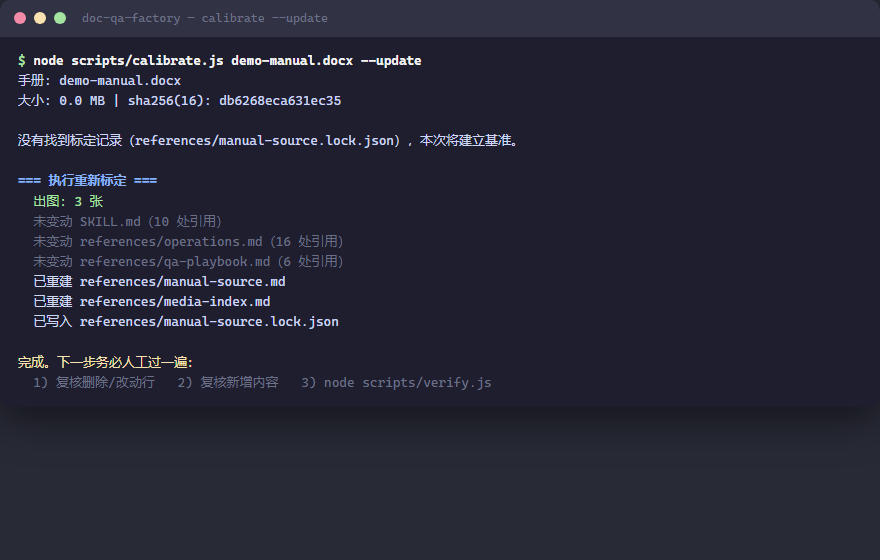

<div align="center">

# doc-qa-factory

**Turn any manual into a verifiable Q&A assistant.**

逐字原文编号锚定 · 图片按章节归属 · 六项一致性校验 · 改版自动重标定

[](https://github.com/vercel-labs/skills)
[](https://github.com/anthropics/skills)
[](https://github.com/vercel-labs/skills)
[](LICENSE)

[English](README.md) | [简体中文](README.zh-CN.md)


</div>

---

An Agent-Skill-format toolkit that loads any product manual / SOP / policy document into a **traceable** Q&A assistant: every answer carries a numbered citation back to the verbatim source text, illustrations are filed by the section they appear in, specific values are never invented, and a manual revision is re-calibrated automatically.

The repo ships with a **fully fictional** demo knowledge base (a desktop sparkling-water maker manual) — install it as a skill and just talk to your agent in plain language. It runs the whole pipeline for you.

## Use it as a skill

Install with one command — it auto-detects the agents on your machine (Claude Code, Cursor, Codex, Copilot, Windsurf, OpenCode and 70+ more) and installs into each one's skills directory:

```bash
npx skills add zhanghaojie513/doc-qa-factory
```

<details>
<summary>Manual install (without npm)</summary>

| Runtime | Install |
|---|---|
| Claude Code | `git clone https://github.com/zhanghaojie513/doc-qa-factory ~/.claude/skills/doc-qa-factory` |
| Generic skills directory | `git clone https://github.com/zhanghaojie513/doc-qa-factory ~/.agents/skills/doc-qa-factory` |
| Other Agent-Skills runtimes | clone anywhere, then register the folder containing `SKILL.md` per your runtime's docs |

</details>

Then just say it — no commands to memorize:

| You say | The assistant does |
|---|---|
| "Load the demo manual." | Calibrates the fictional manual: builds the numbered verbatim baseline, extracts the illustrations and files them by section, then runs six consistency checks — you just see **all green** |
| "The machine shows E1 — what do I do?" | Answers with an actionable, checkable procedure, cites the source line (M015), and **sends the related illustration as a file** |
| "Swap in my company's manual: `D:\docs\printer.docx`" | 🔴 Confirms with you first, archives the demo knowledge base, rewrites the per-manual config, re-calibrates, rebuilds the Q&A playbook — and ships **only after verify is all green** |
| "Which manual is loaded right now?" | Reads the calibration record and reports name / version / checksum |
| "Bring the demo manual back." | Restores the archive, after a 🔴 confirmation |

<details>
<summary>What the assistant runs under the hood (you never type these yourself)</summary>



```bash
node scripts/calibrate.js demo-manual.docx --update   # load: numbering baseline + illustrations + media index
node scripts/verify.js                                # six consistency checks → all green
node scripts/calibrate.js demo-manual.docx            # drift check after any manual revision
```

</details>

## Why this design

The biggest risk of LLMs answering manual questions is not "can't answer" — it's **confidently inventing**: a menu path that doesn't exist, a plausible-but-wrong parameter, an image described wrongly. Four mechanisms close those holes:

| Mechanism | How |
|---|---|
| **Verbatim-source anchoring** | The entire manual is transcribed verbatim and numbered (`M001`–`MNNN`, typos preserved) as the single fact baseline. Every fact in an answer must land on a number, e.g. "filter lifespan is 60 days (M010)" |
| **Images filed by section** | Illustrations are named by *where they appear* in the manual (`filter-01.jpg` = section 「Filter replacement」, 1st image) — never by "what I think the picture shows". The assistant sends the file or reports its position; it never describes or OCRs the image |
| **Six consistency checks** | `verify.js`: citation out-of-range / dead screenshot links / orphan files / value provenance / baseline tampering / prose-vs-source values — any `[FAIL]` blocks shipping |
| **Auto re-calibration on revision** | After a revision, `calibrate` matches each line by content fingerprint, finds where it moved, rewrites every `M###` citation and re-files images automatically — then reports what needs human attention (changed values, deleted lines, new content) |

## Swap in your own manual

You provide three things; the assistant does the rest (Mode A in `SKILL.md`):

1. **The DOCX file** — tell your agent its path; 🔴 it will confirm the swap plan with you before touching anything
2. **A green light** at the confirmation (archive → rewrite config → re-calibrate → rebuild playbook → verify gate)
3. **Insider knowledge** for the new playbook, if you have it: terminology aliases, contact persons, "what the manual does not cover" — the assistant drafts it, you correct it

The per-manual config it rewrites is `references/manual-config.json` (**the scripts themselves contain zero manual content**):

- `docTitle` / `docVersion` — manual name and version
- `expectedTitlePattern` — document-identity guard (a safety lock against calibrating an unrelated document; cross-document swaps use `--force-replace`)
- `headingStyles` — docx heading style IDs (defaults `Heading1`/`Heading2`; Chinese-Word internal style IDs also configurable)
- `imageSlugs` — section title → image filename prefix (unregistered sections get `sec-NN` automatically)
- `watchedValues` / `knownValues` — the specific values to watch (e.g. "valid for X hours"); each one triggers an alarm when the manual changes

Notes: **no ffmpeg?** the assistant still works — images are copied as-is instead of re-encoded. **Non-DOCX** (PDF/TXT/MD): the assistant builds the files manually following the existing formats, then runs the same verify gate.

## Why all-green matters (hard rules)

1. **Never invent specific values** — if the source doesn't have it, say so and route to the contact person; caught per-item by `knownValues` + prose comparison
2. **Never describe images** — image meaning comes from that section's text; send the file (preferred) or report its position, no OCR
3. **Red-light gate** — any `[FAIL]` in `verify.js` blocks "done" declarations; high-risk actions (swap / `--update` / archive restore) sit behind explicit 🔴 CHECKPOINTs requiring user confirmation

## Repository layout

```
doc-qa-factory/
├── SKILL.md                     assistant rules (three modes: build/swap · Q&A · manage)
├── demo-manual.docx             demo manual (fully fictional, re-calibratable)
├── references/
│   ├── manual-config.json       per-manual config (guard/styles/image slugs/watched values) ← rewritten on swap
│   ├── operations.md            standard-operations digest (demo example)
│   ├── troubleshooting.md       troubleshooting digest (demo example)
│   ├── qa-playbook.md           per-manual Q&A playbook (demo example)
│   ├── manual-source.md         verbatim source (generated by calibrate, gitignored)
│   ├── manual-source.lock.json  calibration record (generated)
│   └── media-index.md           image/video → section index (generated)
├── assets/screenshots/          illustrations named by section (extracted from the docx)
├── scripts/
│   ├── docx.js                  dependency-free .docx reader (hand-rolled ZIP + WordprocessingML)
│   ├── zip.js                   dependency-free zip writer (deflate, fixed timestamps → reproducible bytes)
│   ├── calibrate.js             drift detection + re-calibration (numbering/images/index/citations, all automatic)
│   ├── verify.js                six consistency checks
│   └── package.js               distribution packaging (runs verify first; refuses on red)
└── build/                       demo assets & generators (docs GIF, demo docx)
```

## License

MIT
