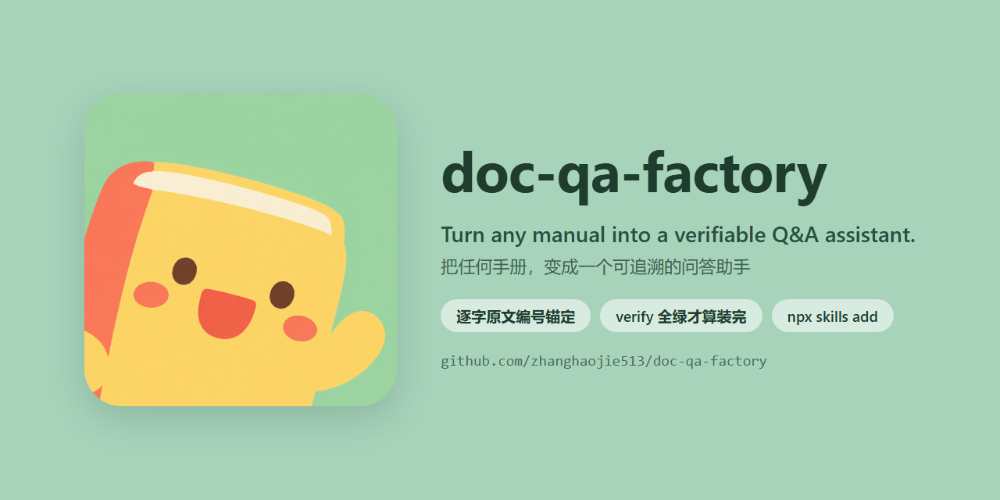
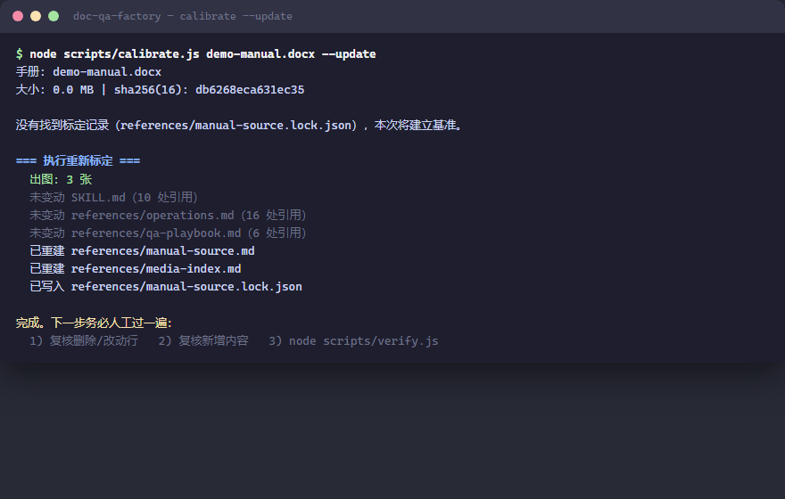

<div align="center">

# doc-qa-factory · 文档问答助手工厂

[](https://github.com/vercel-labs/skills)
[](https://github.com/anthropics/skills)
[](https://github.com/vercel-labs/skills)
[](LICENSE)

[English](README.md) | 简体中文



</div>

---

**Turn any manual into a verifiable Q&A assistant.** 把任何产品手册 / 操作规程 / 制度文档，装载成一个**可追溯**的问答助手：回答带逐字原文编号出处、插图按章节归位可直发、具体值绝不编造、手册改版自动重标定。

仓库出厂自带一份**全虚构**的演示知识库（《桌面气泡水机使用手册》）——把它当 skill 装好，然后**对 agent 说人话就行**，整条流水线由它来跑。

## 安装

为 Claude Code、Codex、Cursor 等 70+ 兼容 agent 打造。最简单的方式：把链接丢给你的 agent：

```
帮我安装这个技能：https://github.com/zhanghaojie513/doc-qa-factory
```

或用 [skills CLI](https://github.com/vercel-labs/skills)（自动探测你机器上装了哪些 agent，装进各自的 skills 目录）：

```bash
npx skills add zhanghaojie513/doc-qa-factory
```

或手动安装：

```bash
git clone https://github.com/zhanghaojie513/doc-qa-factory.git
cd doc-qa-factory
ln -s "$(pwd)" ~/.claude/skills/doc-qa-factory   # Claude Code
ln -s "$(pwd)" ~/.codex/skills/doc-qa-factory    # Codex
ln -s "$(pwd)" ~/.agents/skills/doc-qa-factory   # 通用 skills 目录
```

中国大陆访问 GitHub 慢时，clone URL 前可加代理前缀（如 [gh-proxy](https://gh-proxy.com/)）：`git clone https://gh-proxy.com/https://github.com/zhanghaojie513/doc-qa-factory.git`。

运行要求：Node 18+，**零 npm 依赖**（所有脚本只用 Node 内置模块）；`ffmpeg` 可选（没有就自动降级原图直拷，不阻断）。

然后直接说话就行——没有需要背的命令：

| 你说 | 助手做 |
|---|---|
| 「装载演示手册」 | 标定这份虚构手册：建逐字原文编号基准、提取插图按章节归位、跑六项一致性校验——你只看到**全绿** |
| （还没装载任何手册时就提问） | 如实告知知识库未装载——verify 退出码为 **2**——并提议装载演示手册或你的手册；**绝不凭记忆或示例文件硬答** |
| 「机器显示 E1 怎么办？」 | 给出可照做的排查步骤、带原文出处（M015），并**把相关插图作为文件发给你** |
| 「换装我公司的手册：`D:\docs\打印机维修手册.docx`」 | 🔴 先与你确认方案，归档演示知识库、重写逐手册配置、重新标定、重建 Q&A 预案——**verify 全绿才算装完** |
| 「现在装载的是哪份手册？」 | 读取标定记录，报出文档名 / 版本 / 校验和 |
| 「把演示手册找回来」 | 🔴 确认后从归档恢复 |

<details>
<summary>助手背后自动执行的命令（你不需要自己敲）</summary>



```bash
node scripts/calibrate.js demo-manual.docx --update   # 装载：编号基准 + 插图提取 + 媒体索引
node scripts/verify.js                                # 六项一致性校验 → 全绿
node scripts/calibrate.js demo-manual.docx            # 手册改版后的漂移检测
```

</details>

## 工作原理

一条命令把 DOCX 变成经过校验的知识库，第二条命令证明它：


助手之后说的每一句话，都必须能落到 `references/manual-source.md` 的某一行——正是这一条约束，让编号引用、具体值校验、改版漂移检测全部成为可能。

## 回答长什么样

> **问：怎么换滤芯？**
>
> 滤芯寿命为60天——面板显示 `F0` 就是该换了（M010）。
>
> 1. 逆时针旋下旧滤芯
> 2. 撕除新滤芯密封膜
> 3. 顺时针旋入卡座
> 4. 长按「复位」键3秒清除提示
>
> 📎 插图 `assets/screenshots/filter-01.jpg`（「滤芯更换」一节第 1 张）在 runtime 支持附件时**作为文件直接发出**。助手从不描述图片画了什么——上面该节的文字才是事实基准。

> **问：机器显示 `E1`。**
>
> `E1` = 气压异常：检查 CO2 气瓶是否旋紧、余量是否充足，重新旋紧后按「注气」键重试（M015）。仍不行 → 售后支持，**切勿自行拆卸**（M017）。这一节**没有配图**——助手会如实说明，而不是编一张出来。

## 三种模式

| 模式 | 你说 | 助手做 |
|---|---|---|
| **A · 构建/换装** | 「装载这份手册」「换装我们的操作规程」 | 🔴 先确认方案 → 归档当前知识库 → 重写配置 → 重新标定 → 重建预案 → **verify 全绿才算装完** |
| **B · 问答** | 关于已装载手册的任何问题 | 可照做的步骤 + 编号出处 + 插图文件优先直发 |
| **C · 管理** | 「现在装载的是哪份手册」「把演示手册找回来」 | 读标定记录 / 🔴 确认后从归档恢复 |

## 为什么是这套设计

LLM 答手册类问题的最大风险不是"答不出"，而是**自信地编造**：编一个菜单路径、猜一个参数值、把插图内容看错再讲错。本工厂用四个机制堵死：

| 机制 | 做法 |
|---|---|
| **逐字原文锚定** | 手册全文逐字编号（`M001`–`MNNN`，连错别字都保留）为唯一事实基准；答复里每个事实都要能落到编号上，如"滤芯寿命为60天（M010）" |
| **图片按章节归属** | 插图文件按"出现在手册哪一节、第几张"命名（`filter-01.jpg`），**永不按"我以为图里是什么"命名**；助手只发图或报位置，不描述、不 OCR 图片内容 |
| **六项一致性校验** | `verify.js`：引用越界 / 截图死链 / 冗余图 / 具体值出处 / 基准篡改 / 正文措辞 vs 原文——红灯就不得上线 |
| **改版自动重标定** | 手册改版后 `calibrate` 按逐行内容指纹找出每行搬到哪了，自动改写全部 `M###` 引用、重新归属图片，并报告必须人工处理的部分（值变了 / 行被删 / 新增内容） |

## 换装你自己的手册

你只提供三样东西，其余全是助手的活（见 `SKILL.md` 模式 A）：

1. **DOCX 文件**——告诉 agent 路径即可；🔴 它会先和你确认换装方案再动手
2. **确认时的点头**——归档 → 重写配置 → 重新标定 → 重建预案 → verify 门禁，一条链它自己走完
3. **内幕知识**（有则给）——术语叫法、对接人、"文档里没有的内容"；助手起草，你来纠偏

它重写的逐手册配置是 `references/manual-config.json`（**脚本本体零手册内容**）：

- `docTitle` / `docVersion` — 手册名与版本
- `expectedTitlePattern` — 文档主题守卫（防止误标定到无关文档的安全锁，跨文档换装配合 `--force-replace`）
- `headingStyles` — docx 标题样式 ID（缺省 `Heading1`/`Heading2`；中文 Word 导出的内部样式 ID 也可配置）
- `imageSlugs` — 章节标题 → 图片文件名前缀（未登记的小节自动 `sec-NN`）
- `watchedValues` / `knownValues` — 要盯的具体值清单（如"有效期 X 小时"），改版时逐项报警

备注：**没装 ffmpeg？** 照样能用——插图自动降级为原图直拷，不阻断流程。**非 DOCX**（PDF/TXT/MD）：助手按现有文件格式人工构建，然后走同一个 verify 门禁。手工构建的知识库没有标定 lock——这意味着它**受防误覆盖保护**（普通 `--update` 会被脚本拒绝，必须显式 `--force-replace`），并且助手会主动告知你：这份库无法做漂移检测。

## 全绿为什么重要（三条硬规则）

1. **不编造具体值** — 原文里没有就明说"文档没写"，转对接人；靠 `knownValues` + 措辞比对逐项拦截"凭感觉猜网址"这类事故
2. **不描述图片** — 图片含义以该节正文文字为准；发图（首选）或报位置，不 OCR
3. **红灯门禁** — `verify.js` 有 `[FAIL]` 就不得宣布完成；高危动作（换装 / `--update` / 恢复归档）前有显式 🔴 CHECKPOINT 强制用户确认

## FAQ

**只支持 DOCX 吗？**
DOCX 是全自动路径（编号、插图提取、媒体索引）。PDF/TXT/MD 可以人工构建 references 后装载——走同一个六项校验门禁。

**能同时保留几份手册吗？**
同时只装载一份。每次换装会把上一份知识库归档到 `archive/`，随时可恢复（🔴 确认后）。

**verify.js 报错了怎么办？**
报错就不上线。`SKILL.md` 里每类 `[FAIL]` 都有修法速查表——引用越界、截图死链、冗余文件、具体值出处、基准篡改、正文措辞——每条都有一线修复和最后兜底。退出码：**0** 干净 · **1** 有问题 · **2** 尚未装载。

**手工构建（非 DOCX）的知识库安全吗？**
安全，甚至更稳：没有 lock 就不会被一次误跑的 `--update` 覆盖（脚本直接拒绝），verify 门禁全量生效；助手会坦白唯一的限制——漂移检测需要 lock，所以这项检查不可用时它会明说。

**我的文档会被传到哪里？**
哪里都不传。全流程本地运行：docx 原地读取，插图落在本地 `assets/`，不连接任何外部服务。

**支持哪些 runtime？**
所有读 Agent Skills（`SKILL.md`）的 runtime：Claude Code、Codex、Cursor 等 70+，`npx skills add` 一行装好。

## 参与贡献

欢迎 Issue 和 PR。改行为时请保住三条硬规则——它们就是这个产品本身，不是装饰。演示素材（docx、GIF、截图）都可以从 `build/` 一键重新生成。

吉祥物与社交卡由 `gemini-3-pro-image-preview` 生成；完整候选史与逐张 prompts 在 `docs/logo-candidates/`。

## 仓库结构

```
doc-qa-factory/
├── SKILL.md                     助手行为规则（三模式：构建换装 / 问答 / 管理）
├── demo-manual.docx             演示手册（全虚构，可重复标定）
├── references/
│   ├── manual-config.json       逐手册配置（守卫/样式/图片命名/受监视值）← 换装时重写
│   ├── operations.md            标准流程整理（演示示例）
│   ├── troubleshooting.md       故障排查整理（演示示例）
│   ├── qa-playbook.md           专属 Q&A 预案（演示示例）
│   ├── manual-source.md         逐字原文（由 calibrate 生成，gitignore）
│   ├── manual-source.lock.json  标定记录（生成）
│   └── media-index.md           图/视频 → 章节索引（生成）
├── assets/screenshots/          按章节命名的插图（由 calibrate 从 docx 提取）
├── scripts/
│   ├── docx.js                  无依赖 .docx 读取（手写 ZIP 解析 + WordprocessingML）
│   ├── zip.js                   无依赖 zip 写入（deflate、固定时间戳 → 可字节复现）
│   ├── calibrate.js             漂移检测 + 重新标定（编号/图片/索引/引用全自动）
│   ├── verify.js                六项一致性校验
│   └── package.js               分发打包（先跑 verify，红灯拒绝打包）
└── build/                       演示素材与生成脚本（docs 的 GIF、demo docx）
```

## License

MIT
